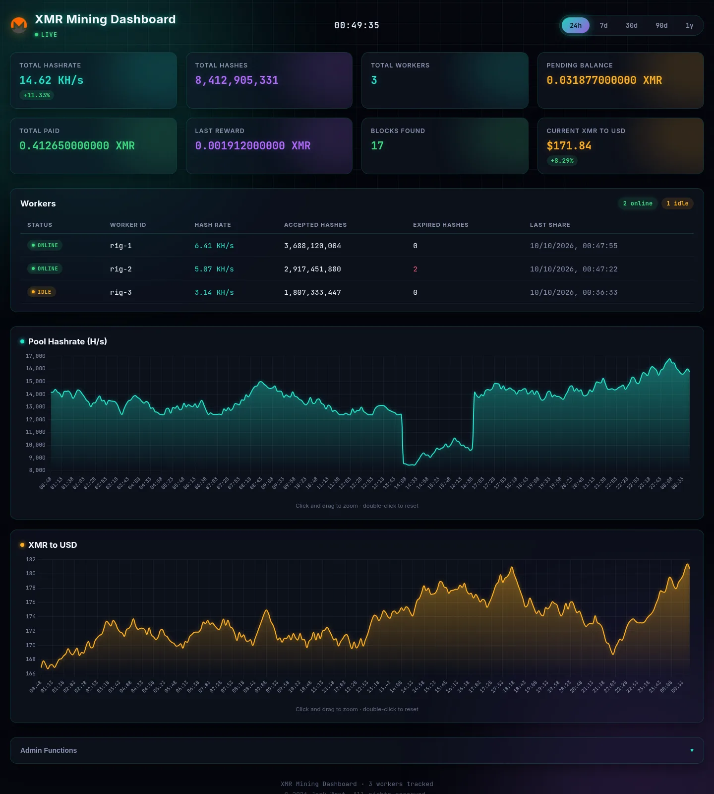

<h1 align="center">XMR Mining Dashboard</h1>

<p align="center">
  <b>A self-hosted Monero (XMR) mining dashboard for xmrpool.eu miners.</b><br>
  Live hashrate, per-worker status, XMR price, a year of history charts, offline alerts and a daily email report.<br>
  Node.js, PostgreSQL and Docker, with no build step.
</p>

<p align="center">
  
  
  
  
  
  <a href="LICENSE"></a>
</p>

<p align="center">
  <a href="https://jackwent.co.uk/xmr-mining-dashboard/"><b>Read the write-up</b></a> ·
  <a href="#quick-start-docker">Quick start</a> ·
  <a href="#api-endpoints">API</a>
</p>

<p align="center">
  
</p>

The pool's own page only shows what's happening now. This keeps the lot: hashrate and price history in PostgreSQL for at least a year, a status pill for every rig, an email when a worker goes offline and when it's back, and a summary in your inbox every morning. It's styled as a neon cyberpunk control room.

> [!NOTE]
> Miner stats come from the **[xmrpool.eu](https://xmrpool.eu)** API for your wallet address. For another pool, change the stats URL in `src/minerStats.js` to match.

## Features

- **Live pool stats:** hashrate, total hashes, workers, pending balance, total paid, last reward and blocks found.
- **Per-worker table** with **online / idle / offline** pills, based on each worker's last share.
- **Offline alerts:** an email when a worker has been offline for 10 minutes (adjustable), and another when it's back. The alert state survives restarts, so you don't get repeats.
- **History charts** for 24h, 7d, 30d, 90d and 1y, for both hashrate and XMR/USD, with at least 365 days kept.
- **XMR → USD price** every 15 minutes from CoinGecko, falling back to CoinCap and then Binance.
- **Daily email report** through Microsoft Graph, plus test-send endpoints.
- **Password-protected admin panel** (optional) for JSON history export and import, using sessions with HMAC-signed cookies.
- **Easy upgrades:** existing SQLite or JSON history is migrated into PostgreSQL automatically.
- **No frontend build:** plain Vue 3 and Chart.js from a CDN.

## Quick start (Docker)

```bash
git clone https://github.com/JackWent/Crypto-Monitor.git
cd Crypto-Monitor
cp .env.example .env          # set XMR_WALLET_ADDRESS and POSTGRES_PASSWORD at least
docker build -t crypto-monitor:local .
IMAGE_TAG=crypto-monitor:local docker compose up -d
```

Then open <http://localhost:7050>. Two containers start: `Crypto-GUI` (the Node app) and `Crypto-DB` (PostgreSQL 16), and the database is ready before the app starts. The email settings are only needed for the daily report and the alerts.

## Project structure

```
.
├── server.js              # Thin bootstrap: middleware, routes, startup sequencing
├── src/
│   ├── config.js           # All environment variable parsing/constants
│   ├── state.js             # Shared in-memory cache (rates, miner stats, sessions)
│   ├── adminAuth.js          # Admin session/cookie/password logic
│   ├── priceService.js        # XMR/USD price fetching (CoinGecko → CoinCap → Binance)
│   ├── minerStats.js           # Pool stats fetching, caching, worker status classification
│   ├── history.js               # Import/export/normalization of historical data
│   ├── cron.js                    # Scheduled jobs (price/hashrate polling, daily email)
│   ├── db/                         # PostgreSQL pool, schema, metrics, legacy migration
│   ├── email/                       # MS Graph client, email HTML template, daily send
│   └── routes/                       # Express routers, grouped by concern
└── public/
    ├── index.html            # Vue 3 app shell (structure only)
    ├── css/styles.css          # Neon cyberpunk theme
    └── js/app.js                 # Vue app logic (Composition API)
```

No build step: the frontend is plain Vue 3 and Chart.js loaded from CDN, so `public/` is served as-is.

## Manual Setup (without Docker)

### Prerequisites

- Node.js (v18 or later)
- npm
- A reachable PostgreSQL instance

### Installation

1. Install dependencies:
   ```bash
   npm install
   ```

2. Create your environment file:
   ```bash
   cp .env.example .env
   ```

3. Start the application:
   ```bash
   npm start
   ```

4. For development with auto-restart:
   ```bash
   npm run dev
   ```

> Note: `better-sqlite3` is an optional dependency used only for one-time migration from a legacy SQLite file. If its native build tools aren't available on your machine, the app logs a warning and skips that migration path — everything else works normally.

## Configuration

- The dashboard reads runtime settings from environment variables (`.env`)
- Email notifications are sent to addresses defined in `.env`
- XMR price is updated every 15 minutes
- Hashrate samples are persisted continuously while the dashboard is active, with scheduled background sampling every 5 minutes
- Miner stats API responses are cached briefly to reduce upstream calls
- Dashboard live cards refresh every 5 seconds; history charts refresh every 30 seconds (and on period change) with request cancellation to avoid stale chart updates
- Worker status pills are derived client-visible from each worker's last-share age: **online** (< 5 min), **idle** (< 30 min), **offline** (otherwise)
- Metric retention is enforced for at least 365 days
- Emails are sent daily at 10 AM

### Environment Variables (`.env`)

- `PORT` (default: `7050`)
- `DATA_DIR` (default: `/data` in Docker)
- `TZ` (default: `Europe/London`)
- `MINER_STATS_CACHE_TTL_MS` (default: `10000`)
- `HASHRATE_SAMPLE_MIN_INTERVAL_MS` (default: `30000`)
- `DATA_RETENTION_DAYS` (minimum enforced: `365`)
- `POSTGRES_HOST` (default: `postgres`)
- `POSTGRES_PORT` (default: `5432`)
- `POSTGRES_DB` (default: `crypto_dashboard`)
- `POSTGRES_USER` (default: `crypto_dashboard`)
- `POSTGRES_PASSWORD` (required for database access, set this to a strong value)
- `POSTGRES_SSL` (`true` or `false`, default: `false`)
- `XMR_WALLET_ADDRESS` (required for miner stats)
- `GRAPH_TENANT_ID` (required for email features)
- `GRAPH_CLIENT_ID` (required for email features)
- `GRAPH_CLIENT_SECRET` (required for email features)
- `GRAPH_SENDER_EMAIL` (required for email features)
- `GRAPH_RECIPIENT_EMAILS` (comma-separated, required for email features)
- `ALERT_RECIPIENT_EMAILS` (optional; who gets worker offline / back-online alerts, defaults to `GRAPH_RECIPIENT_EMAILS`)
- `OFFLINE_ALERT_THRESHOLD_MINUTES` (optional; how long a worker must be offline before an alert, default `10`)
- `DASHBOARD_PUBLIC_URL` (used for links/logo in email body)
- `DASHBOARD_LOGO_URL` (optional absolute URL for email logo image; overrides `${DASHBOARD_PUBLIC_URL}/xmr-logo.png`)
  For reliable email rendering, use a public `https://` URL.
- `ADMIN_PASSWORD` (optional; when set, admin routes/UI require password unlock)
- `ADMIN_SESSION_SECRET` (recommended when `ADMIN_PASSWORD` is set; used to sign admin session tokens)
- `ADMIN_SESSION_TTL_MS` (optional; admin session duration in milliseconds, minimum 15 minutes)
- `ADMIN_COOKIE_SECURE` (`true` or `false`, default: `false`; set `true` for HTTPS-only secure admin cookies)

## API Endpoints

- `/api/miner-stats`: Get current miner statistics (includes per-worker `status`: `online` / `idle` / `offline`)
- `/api/xmr-usd-rate`: Get current XMR to USD rate
- `/api/xmr-usd-history`: Get historical XMR to USD rates (supports `?period=24h`, `?period=7d`, `?period=30d`, `?period=90d`, `?period=1y`)
- `/api/hashrate-history`: Get historical hashrate data (supports `?period=24h`, `?period=7d`, `?period=30d`, `?period=90d`, `?period=1y`)
- `/api/admin/session`: Check whether admin auth is enabled and whether the current session is authenticated
- `/api/admin/login`: Authenticate admin session with password (`POST`, JSON body with `password`)
- `/api/admin/logout`: Clear current admin session (`POST`)
- `/api/export-history`: Export full XMR/hashrate history from PostgreSQL to `/data/xmr_history.json` and `/data/hashrate_history.json`
- `/api/export-history/:historyType/download`: Download a full export JSON for `xmr` or `hashrate`
- `/api/import-history`: Import history JSON data via file upload or JSON body
- `/send-daily-email`: Manually trigger the daily email
- `/test-email`: Send a test email with custom subject and content
- `/test-email-with-stats`: Send a test email with mining statistics
- `/health`: JSON health/status report
- `/healthz`: Plain-text liveness check

Admin-only routes (`/api/import-history`, `/api/export-history*`, `/send-daily-email`, `/test-email*`) are protected when `ADMIN_PASSWORD` is configured.

## Maintenance

- Metrics are stored in PostgreSQL tables: `xmr_rate_history`, `hashrate_history`, and `miner_stats_snapshots`
- Metric history timestamps are deduplicated and uniquely indexed in PostgreSQL to prevent duplicate points
- Existing legacy data from `/data/dashboard.db`, `/data/xmr_history.json`, and `/data/hashrate_history.json` is auto-migrated when PostgreSQL tables are empty
- Automatic pruning keeps at least the configured retention period, with a hard minimum of 365 days
- You can export fresh JSON backup files from the Admin panel before rebuilding containers, then restore them with the import tool
- You can also import historical backup files manually from the Admin panel in the dashboard

## Licence

Released under the MIT licence. See [LICENSE](LICENSE).

More self-hosted projects and write-ups are at [jackwent.co.uk](https://jackwent.co.uk).
